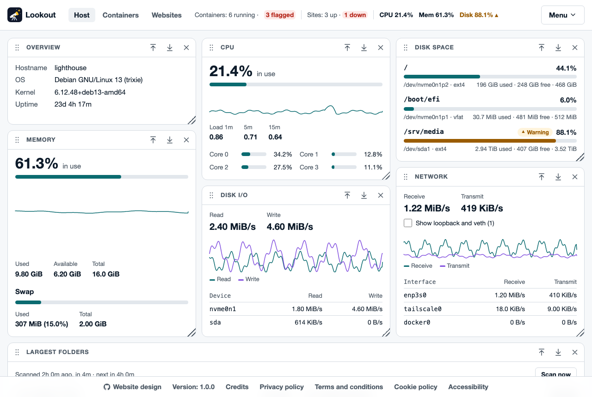
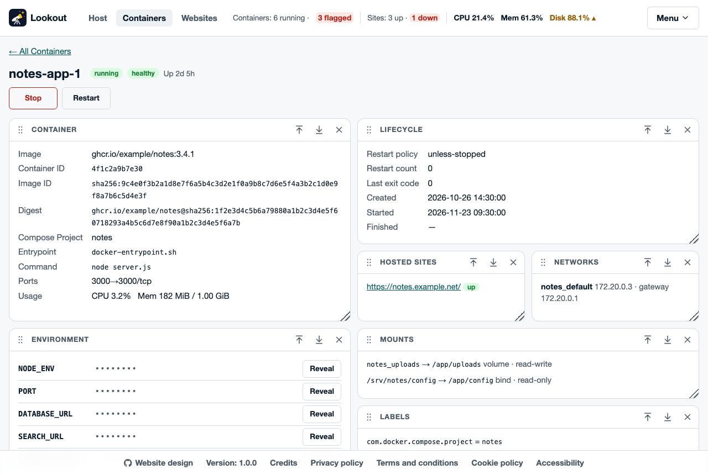
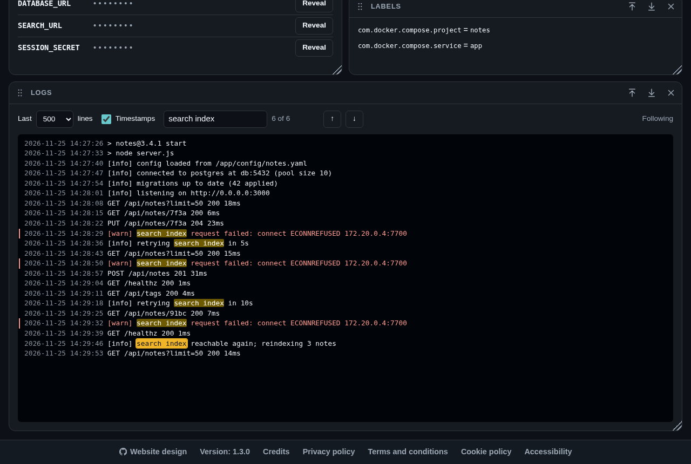
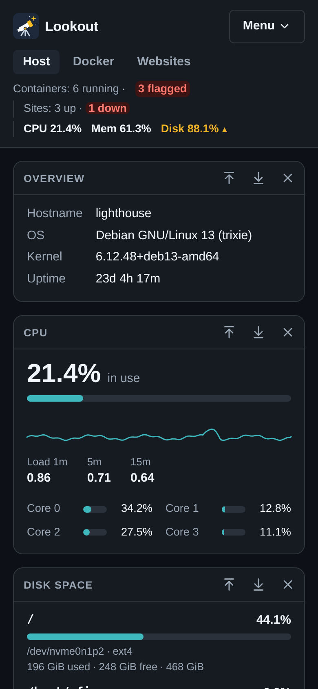
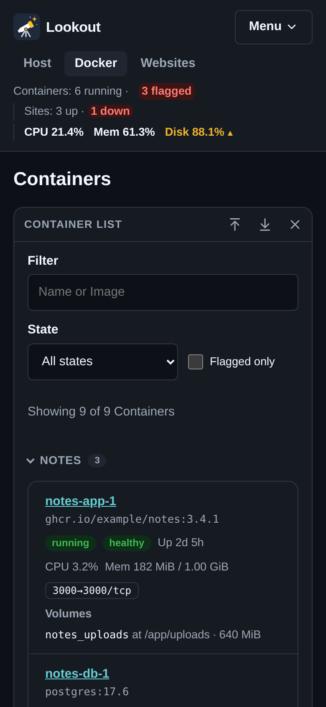
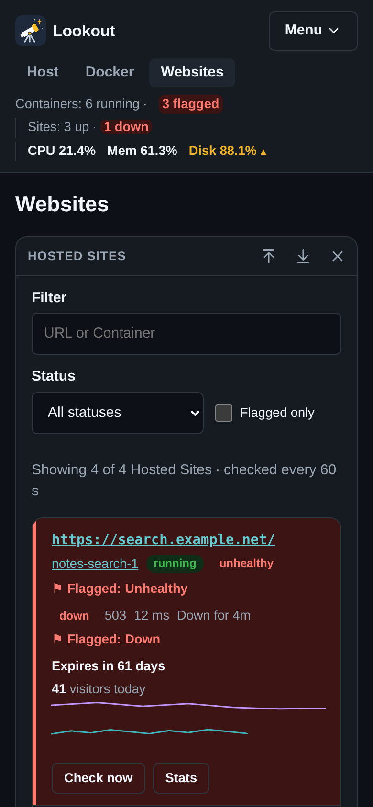

# Lookout

A lightweight, self-hosted dashboard for the health of your Linux server and the Docker containers running on it.

<picture>
  <source srcset="docs/images/host-dark-desktop.png" media="(prefers-color-scheme: dark)" />
  
</picture>

Website: [lookout.adrianeyre.co.uk](https://lookout.adrianeyre.co.uk) · Repository: [github.com/adrianeyre/lookout](https://github.com/adrianeyre/lookout)

> [!WARNING]
> **Lookout has root-equivalent access to your server.** It talks to the Docker socket, and anyone who can use Docker can take over the Host. Only ever reach Lookout over your LAN or a VPN such as Tailscale. Never expose it to the internet, and never put it behind a public reverse proxy. Read [Security](#security) before installing.

## What it does

- **Host Metrics, live:** CPU (overall and per core, load averages), memory and swap, disk space per filesystem, disk I/O, network throughput and uptime, with sparklines for the last 15 minutes and amber/red thresholds.
- **Containers:** every Container grouped by Compose Project, with state, health, uptime, ports, CPU and memory. Restarting, unhealthy and failed Containers are **Flagged**, and the header always shows how many.
- **Container detail:** Image and digest, command, environment variables (masked until you reveal one), mounts, networks, labels and restart history. Passwords and tokens in the command, labels and mount paths are masked too, each revealed on its own.
- **Live logs:** stdout and stderr interleaved, follow mode, timestamps, and search with highlighted matches.
- **Websites:** every Hosted Site the Host serves (found from Traefik labels, a `lookout.url` label or `LOOKOUT_SITES`), checked every minute: up, slow or down, the status code, response time, TLS certificate expiry, and the state of the Container behind it. Down sites and certificates about to expire are **Flagged**.
- **Site Stats:** each Hosted Site's visitors, page views, bots, status codes and response times from your reverse proxy's access logs, plus uptime, certificate expiry, and its disk and Docker space, kept as daily totals for 90 days and drawn as charts on its own page. The Host page adds Docker's disk usage, with what could be reclaimed.
- **Container Actions with guard-rails:** start, stop and restart (with confirmation), and remove stopped Containers (type the name to confirm). Lookout never touches its own Container, never removes volumes and never force-removes. There is deliberately no shell.
- **Largest folders.** The ten folders using the most disk space, anywhere on the Host, each with a bar of its share of its disk. Scanned gently every 6 hours, or when you ask; folders Lookout cannot read are counted and named as left out.
- **Widgets you arrange.** Every section can be dragged, resized, pinned or hidden, from the mouse or the keyboard, and each page remembers its layout in your browser.
- **Light and dark, six themes, and it works on a phone.** Settings (in the Menu) chooses System, Light or Dark and one of six themes, all meeting WCAG 2.2 AA, and changes the password. One small Container, no database server, no agents, no telemetry.

## Quick start

You need a Linux Host (amd64 or arm64, for example a Raspberry Pi 4 or 5) with Docker Engine 24 or later and the Compose plugin. You do not need Node. This takes about five minutes.

```sh
mkdir lookout && cd lookout
curl -fsSLO https://raw.githubusercontent.com/adrianeyre/lookout/main/compose.yaml

# 1. Choose a password. This prints a LOOKOUT_PASSWORD_HASH=… line, with each $ already
#    written as $$ for Compose: copy it into .env.
docker run --rm -it ghcr.io/adrianeyre/lookout:1.0 hash-password --env
nano .env

# 2. A secret for signing session cookies, and the Docker socket's group.
echo "LOOKOUT_SESSION_SECRET=$(openssl rand -base64 32)" >> .env
echo "DOCKER_GID=$(stat -c %g /var/run/docker.sock)" >> .env

# 3. The address to listen on: your Tailscale or LAN address, never a public one.
#    `tailscale ip -4` or `ip -4 addr` shows it.
echo "LOOKOUT_BIND_ADDRESS=100.101.102.103" >> .env

docker compose up -d
```

Then open `http://<that address>:7777` and sign in. To reach it by a name instead (a Tailscale MagicDNS name, say), add that name to `LOOKOUT_HOSTNAMES`. `docker compose logs lookout` shows what went wrong if it does not start; Lookout refuses to start with an invalid setting and names it.

[`compose.yaml`](compose.yaml) uses the host network (so the network figures are the Host's), mounts the Docker socket, and mounts the Host's root filesystem **read-only** at `/host` so the metrics describe the Host rather than Lookout's own Container. It labels the Container `lookout.self=true`, which is how Lookout knows never to stop, restart or remove itself.

> [!NOTE]
> Every `$` in the password hash must be written as `$$` in `.env` or `compose.yaml`, because Compose reads `$` as the start of a variable. `hash-password --env` does this for you; plain `hash-password` prints the raw hash.

## Configuration

Everything is set by environment variable, in `.env` next to `compose.yaml`.

| Variable                      | Default        | What it does                                                                                                                                                                                                                                                                           |
| ----------------------------- | -------------- | -------------------------------------------------------------------------------------------------------------------------------------------------------------------------------------------------------------------------------------------------------------------------------------- |
| `LOOKOUT_PASSWORD_HASH`       | _(required)_   | Argon2id hash of the login password, from `hash-password`. Only the hash is ever stored.                                                                                                                                                                                               |
| `LOOKOUT_SESSION_SECRET`      | _(required)_   | Part of the key that signs session cookies. At least 32 random bytes; `openssl rand -base64 32` makes one. A repeated, patterned or placeholder value is refused at start.                                                                                                             |
| `LOOKOUT_BIND_ADDRESS`        | `127.0.0.1`    | The IP address to listen on: your Tailscale or LAN address. Required by `compose.yaml`. Never a public address, and avoid `0.0.0.0` on a public Host.                                                                                                                                  |
| `DOCKER_GID`                  | _(required)_   | Compose only: the Docker socket's group (`stat -c %g /var/run/docker.sock`), so the non-root Image can reach it.                                                                                                                                                                       |
| `LOOKOUT_PORT`                | `7777`         | The port to listen on.                                                                                                                                                                                                                                                                 |
| `LOOKOUT_HOST_ROOT`           | `/host`        | Where the Host's root filesystem is mounted inside the Container.                                                                                                                                                                                                                      |
| `LOOKOUT_SAMPLE_INTERVAL_MS`  | `2000`         | How often Host Metrics are sampled, 250 to 60000 ms.                                                                                                                                                                                                                                   |
| `LOOKOUT_LIVE_WINDOW_MINUTES` | `15`           | How much history the sparklines keep, in memory only, 1 to 60 minutes.                                                                                                                                                                                                                 |
| `LOOKOUT_WARN_PERCENT`        | `80`           | Amber threshold for CPU, memory, swap and disk.                                                                                                                                                                                                                                        |
| `LOOKOUT_CRITICAL_PERCENT`    | `90`           | Red threshold. Must be higher than the warn threshold.                                                                                                                                                                                                                                 |
| `LOOKOUT_SESSION_IDLE_DAYS`   | `7`            | Sign out after this many days without a visit, 1 to 365.                                                                                                                                                                                                                               |
| `LOOKOUT_SESSION_MAX_DAYS`    | `30`           | Sign out this many days after signing in, however often you visit, 1 to 365. Must be at least `LOOKOUT_SESSION_IDLE_DAYS`.                                                                                                                                                             |
| `LOOKOUT_HOSTNAMES`           | _(none)_       | Host names Lookout answers to, comma-separated (for example `server.tailnet.ts.net`). IP addresses and `localhost` always work; any other name is refused, which stops DNS rebinding.                                                                                                  |
| `LOOKOUT_SECURE_COOKIE`       | `false`        | `true` always marks the session cookie `Secure`, for an HTTPS proxy that does not send `X-Forwarded-Proto`. Signing in over plain HTTP then fails.                                                                                                                                     |
| `LOOKOUT_DATA_DIR`            | _(none)_       | Where a password changed in Settings is kept, as an Argon2id hash in `password.json` (mode 600), and Site Stats' totals in `stats.db`. `compose.yaml` sets `/data` on the `lookout-data` volume. Unset, the password can only be changed in `.env` and Site Stats are lost on restart. |
| `LOG_LEVEL`                   | `info`         | Server log level: `warn`, `info` or `debug`.                                                                                                                                                                                                                                           |
| `DOCKER_HOST`                 | _(the socket)_ | Optional: another Engine address, `unix:///path` or `tcp://host:2375`. TLS is not supported.                                                                                                                                                                                           |

Hosted Sites ([Websites](#websites)):

| Variable                              | Default  | What it does                                                                                                                                                                                                                                                                |
| ------------------------------------- | -------- | --------------------------------------------------------------------------------------------------------------------------------------------------------------------------------------------------------------------------------------------------------------------------- |
| `LOOKOUT_SITES`                       | _(none)_ | Extra Hosted Sites to check, as comma-separated `http` or `https` URLs. Lookout refuses to start with an invalid one. Add `=/folder` to an entry (`https://cdn.example.com=/srv/cdn`) to size a site with no Container by the folder it serves ([Site Stats](#site-stats)). |
| `LOOKOUT_SITE_CHECK_INTERVAL_SECONDS` | `60`     | How often every Hosted Site is checked, 1 to 3600 seconds.                                                                                                                                                                                                                  |
| `LOOKOUT_SITE_TIMEOUT_MS`             | `10000`  | A check with no response after this long is down. No longer than the interval.                                                                                                                                                                                              |
| `LOOKOUT_SITE_SLOW_MS`                | `2000`   | A response slower than this is slow.                                                                                                                                                                                                                                        |
| `LOOKOUT_TLS_WARN_DAYS`               | `14`     | Amber when a certificate expires within this many days.                                                                                                                                                                                                                     |
| `LOOKOUT_TLS_CRITICAL_DAYS`           | `7`      | Red within this many days. Must be lower than the warn days.                                                                                                                                                                                                                |
| `LOOKOUT_FOLDER_SCAN_HOURS`           | `6`      | How often the Host's largest folders are scanned, 0 to 168 hours. 0 scans only when you press Scan now.                                                                                                                                                                     |

Site Stats ([Site Stats](#site-stats)):

| Variable                       | Default  | What it does                                                                                                                                                                           |
| ------------------------------ | -------- | -------------------------------------------------------------------------------------------------------------------------------------------------------------------------------------- |
| `LOOKOUT_ACCESS_LOGS`          | _(none)_ | Your reverse proxy's access logs (Caddy JSON), under `LOOKOUT_HOST_ROOT`, with `*` and `?` allowed in the file name, such as `/host/var/log/caddy/*.log`. Unset hides visitor figures. |
| `LOOKOUT_STATS_RETENTION_DAYS` | `90`     | Days of daily totals kept, 7 to 365. Hourly totals are kept 48 hours.                                                                                                                  |

## Websites

The **Websites** page lists every **Hosted Site**: a website served from the Host that Lookout checks. They come from three places, and the same URL from several of them is one Hosted Site:

1. **Traefik router labels**, discovered automatically. Each host in a `traefik.http.routers.<name>.rule` label's `Host(...)` matchers becomes a Hosted Site, `https` when the router has `tls` labels or a `websecure`/`https` entrypoint. `HostRegexp`, path-only rules and Containers with `traefik.enable=false` are skipped.
2. **A `lookout.url` label** on any Container, for sites not behind Traefik: `lookout.url: "https://wiki.example.com/"` (several can be comma-separated).
3. **`LOOKOUT_SITES`**, for anything else.

A Hosted Site from a label is linked to its Container, so "the site is down and its Container is restarting" shows as one problem, on both the Websites page and the Container's detail view.

Every check is one `GET` that does not follow redirects. A response below 500 is **up** (a 401 or a redirect is up), slower than `LOOKOUT_SITE_SLOW_MS` is **slow**, and a 5xx, timeout, refused connection, DNS error or TLS error is **down**. For `https` sites the certificate's expiry, issuer and hostname are checked as well. A short-lived certificate, one whose whole lifetime is under about six weeks (Caddy's local CA issues 12-hour ones, and Let's Encrypt offers 6-day ones), is judged by its lifetime rather than the days: amber with a third of it left, when it should already have been renewed, and red with a sixth left. So a certificate that renews itself is never Flagged just for being short-lived. Down sites and certificates at red are **Flagged** and sorted first, and the header shows `Sites: 6 up · 1 down` on every page. **Check now** rechecks one site straight away. The latest results are kept in memory, like the sparklines; [Site Stats](#site-stats) keep daily uptime totals.

**Checks connect to the Host itself** (`127.0.0.1`), sending the site's hostname in the request and the TLS handshake, so they work without hairpin NAT or split DNS ([ADR-0010](docs/architectural-decision-record/0010-hosted-sites-checked-from-the-host.md)). That means they cannot see DNS or port-forwarding faults outside the Host. To check a Container's sites through their public URL instead, label it `lookout.check: public`. Lookout never sends alerts; it is a dashboard.

## Site Stats

Each row on the **Websites** page shows today's visitors and a 7-day sparkline, and its **Stats** link opens that Hosted Site's **Site Stats** page. It has Widgets you can arrange like any other, with a 24 hours / 7 / 30 / 90 days switch (hourly points for 24 hours, daily ones otherwise):

- visitors, page views and requests, people and bots, and status codes (2xx, 3xx, 4xx and 5xx);
- response time (p50 and p95), and the top 10 pages and referrer domains;
- uptime and latency, from the checks Lookout already runs, and how many days the certificate has left;
- disk and Docker space over 90 days, with **Measure now**, and the Compose Project's Containers.

Totals are kept by hour for 48 hours and by day for `LOOKOUT_STATS_RETENTION_DAYS`, in `stats.db` in `LOOKOUT_DATA_DIR`. Only counts and sizes are stored, never an IP address ([ADR-0013](docs/architectural-decision-record/0013-daily-stats-history-on-disk.md)).

**Visitors come from your reverse proxy's access logs** ([ADR-0014](docs/architectural-decision-record/0014-visitor-stats-from-access-logs.md)). Caddy's JSON format is supported today.

- **Visitor:** a distinct client address among people, with an IPv6 /64 counting as one.
- **Page view:** a successful `GET` answered with HTML.
- **Bots:** told apart by user agent and counted separately. Lookout's own checks are never counted.
- **Top pages:** kept without their query strings.

Behind a Cloudflare tunnel, the visitor's address is taken from `CF-Connecting-IP`, but only when the request reached Caddy from loopback, where `cloudflared` connects from.

Give every site block a `log` that writes JSON to a file Lookout can read (it runs as UID 65532), for example in a snippet each site imports:

```caddyfile
(access_log) {
	log {
		output file /var/log/caddy/access.log {
			roll_size 50MiB
			roll_keep_for 168h
			mode 644
		}
		format json
	}
}

shop.example.com {
	import access_log
	reverse_proxy 127.0.0.1:3000
}
```

If Caddy runs in a Container, bind-mount the Host's `/var/log/caddy` into it (`- /var/log/caddy:/var/log/caddy`) so the file is on the Host. Then set `LOOKOUT_ACCESS_LOGS=/host/var/log/caddy/*.log`. Lookout follows the files as they grow, carries on where it left off after a restart, and copes with Caddy rotating them. The raw logs hold IP addresses, so keep them only as long as you need: `roll_keep_for 168h` keeps 7 days.

**Sizes** are measured daily at 03:00 (server time) and when you press **Measure now**.

- **A site with a Container:** its Compose Project's named volumes, the Images its Containers run, and their writable layers. Link a site to its Container with a `lookout.url` label, or a Traefik label.
- **A site without one,** such as a static file server: give its `LOOKOUT_SITES` entry the folder it serves, `https://cdn.example.com=/srv/cdn`. The folder is walked read-only through `/host`, like Largest folders.

The Host page's **Docker disk** Widget shows images, Containers, volumes and build cache, each with how much `docker system prune` could reclaim. Lookout only measures: it never prunes or deletes anything.

## Changing the password

**Settings → Password** changes it: type the current password, then the new one (at least 8 characters) twice. Every other browser is signed out; yours stays signed in. A wrong current password counts against the same limit as a failed sign-in. The new password is kept as an Argon2id hash in `LOOKOUT_DATA_DIR` (the `lookout-data` volume in `compose.yaml`), never the password itself ([ADR-0012](docs/architectural-decision-record/0012-password-changed-in-settings.md)).

Forgotten it? Put a new `LOOKOUT_PASSWORD_HASH` in `.env` (`hash-password --env`) and run `docker compose up -d`: a hash in `.env` that has changed always wins over one chosen in Settings.

## Security

Lookout is built for one person watching their own server over a private network ([ADR-0008](docs/architectural-decision-record/0008-single-password-private-network.md)). Please take these seriously:

- **Docker access is root access.** Lookout mounts `/var/run/docker.sock`. Anyone who signs in, or who finds a flaw in Lookout, can control every Container and, through Docker, the Host itself. Treat the Lookout password like the Host's root password.
- **LAN or VPN only, never public.** Set `LOOKOUT_BIND_ADDRESS` to your [Tailscale](https://tailscale.com) address (`tailscale ip -4`) or a LAN address. Do not port-forward it, do not publish it through a tunnel or a public reverse proxy, and do not bind `0.0.0.0` on a Host with a public interface. With `network_mode: host`, the bind address is what decides who can connect.
- **No TLS of its own.** A VPN such as Tailscale encrypts the connection. If you put Lookout behind your own HTTPS proxy on the private network, add the name you reach it by to `LOOKOUT_HOSTNAMES`; the cookie becomes `Secure` when the proxy sends `X-Forwarded-Proto: https` (Caddy and Traefik do; with nginx add `proxy_set_header X-Forwarded-Proto $scheme;`), or always with `LOOKOUT_SECURE_COOKIE=true`.
- **What protects it:** one Argon2id-hashed password; signed `HttpOnly`, `SameSite=Strict` session cookies that expire after `LOOKOUT_SESSION_IDLE_DAYS` idle and `LOOKOUT_SESSION_MAX_DAYS` in all, and end when Lookout restarts or the password changes; 5 failed logins per 15 minutes per address (an IPv6 /64 counts as one), with at most 4 password checks running at once; answers only when the request's `Host` is an IP address, `localhost` or a name in `LOOKOUT_HOSTNAMES` (anything else, such as a rebound DNS name, gets 421); an `Origin` check on every request that changes something; a strict Content Security Policy; environment values, and passwords or tokens in the command, labels and mounts, masked until revealed one at a time, with Lookout's own never revealed; the Host filesystem mounted read-only; and Container Actions limited to start, stop, restart and remove, never on Lookout itself ([ADR-0005](docs/architectural-decision-record/0005-container-actions-without-shell.md)).
- **Running as non-root.** The Image runs as the unprivileged `lookout` user, UID and GID 65532, a user no Host account uses, with only the Docker socket's group added. Through the read-only `/host` mount it can read only what any user on the Host may, never your own home (`~/.ssh`, `~/.docker`). `compose.yaml` also drops every capability, forbids new privileges, makes Lookout's filesystem read-only (except the `lookout-data` volume, which holds only a password hash chosen in Settings) and caps its memory at 256 MiB. That keeps a bug in Lookout from running as root inside its Container or reading your files, but it does **not** make Docker access any less root-equivalent. If a filesystem's mount point is only readable by root, its disk space is not shown, and folders only root or their owner may list are left out of Largest folders: that is the price of not reading what is not Lookout's to read. Do not run Lookout as root.
- **Lookout warns about a public bind address.** If `LOOKOUT_BIND_ADDRESS` is `0.0.0.0`, `::` or an address that is not loopback, private (RFC 1918 or IPv6 ULA), link-local or Tailscale's (`100.64.0.0/10`), Lookout logs a warning naming it at start.
- **Hosted Site checks.** URLs come only from `LOOKOUT_SITES` and Container labels; nothing in the UI or API takes a URL. A label may come from whoever published the Image, not from you, so a label URL is checked at the Host only on port 80, 443 or a port its Container publishes, a `lookout.check: public` check never connects to a private, loopback or cloud-metadata address, and one Container's labels name at most 20 Hosted Sites, after every `LOOKOUT_SITES` entry. List any other URL in `LOOKOUT_SITES`. Response bodies are never read, and TLS verification is never turned off ([v1.1 security review](docs/security-review-v1.1.md), [ADR-0010](docs/architectural-decision-record/0010-hosted-sites-checked-from-the-host.md)).
- **Site Stats.**
  - **Stored:** only counts and sizes, in `stats.db` in `LOOKOUT_DATA_DIR`. Client IP addresses are held in memory for the current hour and day only. Paths are kept without their query strings, and referrers as their domain.
  - **Access logs:** opened read-only through `/host`, never through a link that leads outside it. Over-long or malformed lines are skipped, and at most 200 hosts are counted a day.
  - **`CF-Connecting-IP`:** believed only from loopback, so nobody else can make up visitors with it.
  - **Measure now:** only reads (Docker's `/system/df` and an lstat walk of a site's folder) and never prunes. It runs one at a time, behind the same session and `Origin` checks as every other action ([v1.2 security review](docs/security-review-v1.2.md)).
- The [v1 security review](docs/security-review-v1.md) lists every check and its test. Please report vulnerabilities privately through [GitHub's security advisories](https://github.com/adrianeyre/lookout/security/advisories/new), not in a public issue.

### Narrowing Docker access

For a smaller blast radius, put a filtering proxy between Lookout and the Docker socket ([ADR-0011](docs/architectural-decision-record/0011-optional-docker-socket-proxy.md)). [`compose.socket-proxy.yaml`](compose.socket-proxy.yaml) adds [wollomatic/socket-proxy](https://github.com/wollomatic/socket-proxy), which allows only the Engine API endpoints Lookout uses; Lookout then has no socket of its own:

```sh
curl -fsSLO https://raw.githubusercontent.com/adrianeyre/lookout/main/compose.socket-proxy.yaml
docker compose -f compose.yaml -f compose.socket-proxy.yaml up -d
```

Someone who compromised Lookout could then still read Container details (including environment values) and start, stop, restart or remove Containers, but could no longer `exec` into them, create a Container with the Host's filesystem mounted, or pull Images. The proxy has no network and no TCP port: it listens on a Unix socket in a volume only it and Lookout mount, which only Lookout's user may open, so no other process on the Host reaches it. It uses about 10 MB of memory and needs Docker Compose 2.24 or later. It checks each request's method and path, not its query, so it would let Lookout force-remove a running Container with its volumes; Lookout's code never asks to ([ADR-0011](docs/architectural-decision-record/0011-optional-docker-socket-proxy.md) records this until the next review). It is opt-in because it is one more Container to run and update.

## Updating and versions

```sh
docker compose pull && docker compose up -d
```

Images are published to `ghcr.io/adrianeyre/lookout` for `linux/amd64` and `linux/arm64`, with provenance and an SBOM attached:

| Tag            | Follows                                                                                  |
| -------------- | ---------------------------------------------------------------------------------------- |
| `:1.0` (`X.Y`) | **Recommended.** The latest patch release of that minor version: fixes, no surprises.    |
| `:1.0.3`       | One exact release, for pinning or rolling back.                                          |
| `:latest`      | Every release, including new minor and major versions.                                   |
| `:edge`        | Every merge to `main`, untested by a release. `:sha-<commit>` names one of these builds. |

To move to a new minor version, change the tag in `compose.yaml` and read its [release notes](https://github.com/adrianeyre/lookout/releases) first. The running version is in the footer of every page. Releases are made by [semantic-release](https://semantic-release.gitbook.io) from conventional commit messages, and each one is listed in [`CHANGELOG.md`](CHANGELOG.md).

### Verifying an Image

A tag such as `:1.0` moves with every patch release. Every Image the workflows push from this public repository carries signed build provenance (GitHub keeps attestations for private repositories only on its Enterprise plan, so Images built before the repository went public have none), so you can check that the one you pulled was built from this repository by its own workflow before you run it (needs the [GitHub CLI](https://cli.github.com)):

```sh
gh attestation verify oci://ghcr.io/adrianeyre/lookout:1.0 --owner adrianeyre
```

To run exactly the Image you verified, pin it by digest in `compose.yaml` (`image: ghcr.io/adrianeyre/lookout:1.0@sha256:…`, the digest `docker compose pull` printed), and change the pin when you upgrade.

## Troubleshooting

| What you see                                            | Likely cause and fix                                                                                                                                                                                                                                                                                  |
| ------------------------------------------------------- | ----------------------------------------------------------------------------------------------------------------------------------------------------------------------------------------------------------------------------------------------------------------------------------------------------- |
| `docker compose up` says a variable is required         | A line is missing from `.env`. The message names it.                                                                                                                                                                                                                                                  |
| The Container exits with "Lookout cannot start"         | An invalid setting; the log names every one. A password hash that "is not a valid Argon2id hash" usually means its `$` were not written as `$$`.                                                                                                                                                      |
| The page does not load                                  | Lookout listens only on `LOOKOUT_BIND_ADDRESS`. Use exactly that address, and check `docker compose ps` says `healthy`.                                                                                                                                                                               |
| Containers page says **Docker unavailable**             | The Docker socket is not mounted, or `DOCKER_GID` is not the socket's group (`stat -c %g /var/run/docker.sock`), so Lookout cannot open it. The Host page keeps working meanwhile, and Lookout reconnects on its own.                                                                                 |
| Metrics look wrong: tiny memory, one disk, odd hostname | The Host root is not mounted, so Lookout is reading its own Container. Check the `- /:/host:ro,rslave` volume in `compose.yaml`.                                                                                                                                                                      |
| A disk is missing from Disk space                       | Its mount point is not readable by Lookout's unprivileged user. See [Running as non-root](#security).                                                                                                                                                                                                 |
| Network shows only `lo`, or no traffic                  | `network_mode: host` was removed; Lookout then sees its own Container's network.                                                                                                                                                                                                                      |
| A Hosted Site says "Not checked"                        | It came from a Container label on a port that Container does not publish, or with `lookout.check: public` it points at a private or loopback address. A label may come from an Image's publisher, so Lookout only checks such URLs within bounds; list the URL in `LOOKOUT_SITES` to check it anyway. |
| A Hosted Site is down in Lookout but works in a browser | Checks connect to the Host (`127.0.0.1`) on the URL's port. If nothing on the Host listens there (the site is served elsewhere), label its Container `lookout.check: public` or remove it from `LOOKOUT_SITES`.                                                                                       |
| A Traefik site is missing from Websites                 | Its router rule has no `Host(...)` (for example `HostRegexp` or a path-only rule), or the Container has `traefik.enable=false`. `LOG_LEVEL=debug` logs each router that was skipped.                                                                                                                  |
| "Too many failed attempts"                              | Five wrong passwords in 15 minutes from that address. Wait, or restart Lookout to reset it.                                                                                                                                                                                                           |
| "Lookout does not answer to this host name"             | You reached Lookout by a name it does not know. Add the name to `LOOKOUT_HOSTNAMES`, or use its IP address.                                                                                                                                                                                           |
| Signed out after an update or restart                   | Expected: restarting Lookout signs everyone out, so a logged-out cookie can never work again.                                                                                                                                                                                                         |

## Screenshots

These come from the [screenshot harness](apps/web/screenshots/), which renders the real UI with made-up data, never from a real server. `pnpm screenshots` regenerates them.

<p>
  
</p>

<p>
  
</p>

On a phone:

<p>
  &nbsp;
  &nbsp;
  
</p>

## Footprint

Lookout exists because the alternatives were too heavy ([ADR-0001](docs/architectural-decision-record/0001-build-rather-than-adopt.md)), so its footprint is measured rather than assumed (PRD NFR-1, NFR-2). `pnpm measure --image <tag>` runs the Image against the real Docker daemon with a real browser and checks the budgets:

<!-- measure:start -->

Measured on 25 November 2026 with the Image on Docker 29.9 (linux/arm64), at the default 2 s sample interval:

| Measurement                                          | Result                  | Budget    |     |
| ---------------------------------------------------- | ----------------------- | --------- | --- |
| Idle RSS (no browser)                                | 94.8 MB                 | < 100 MB  | ✅  |
| Idle CPU (no browser)                                | 0.33%                   | < 2%      | ✅  |
| CPU, one browser on the Host page                    | 0.36%                   | < 2%      | ✅  |
| RSS, one browser connected                           | 90.8 MB                 | < 100 MB  | ✅  |
| CPU, one browser on the Containers page (with stats) | 0.43%                   | < 2%      | ✅  |
| Docker state change → UI (20 changes)                | median 50 ms, max 54 ms | < 2000 ms | ✅  |

RSS is the whole process as the kernel counts it, including about 64 MB of the Node binary's own file-backed pages, which are shared and reclaimable. `docker stats` reports less, because it does not count those pages.

<!-- measure:end -->

## Development

You need Node 26 and pnpm 12. pnpm installs the exact Node version pinned in `package.json`.

```sh
pnpm install
pnpm dev            # Fastify on :7777 and Vite on http://localhost:5173
```

`pnpm dev` reads a `.env` file at the repo root if there is one. Without `LOOKOUT_PASSWORD_HASH` the password is `lookout`. On Linux it reads the real Host (`/`); elsewhere it reads the fixture Host in `e2e/fixtures/host`. It uses your real Docker if it can reach it.

| Command                           | What it does                                                                          |
| --------------------------------- | ------------------------------------------------------------------------------------- |
| `pnpm test`                       | Unit and component tests (Vitest)                                                     |
| `pnpm test:e2e`                   | Builds the SPA and runs the Playwright tests against a fixture Host and a fake Docker |
| `pnpm lint` / `pnpm format:check` | ESLint and Prettier                                                                   |
| `pnpm typecheck`                  | TypeScript across the workspace                                                       |
| `pnpm build`                      | Builds the SPA into `apps/web/dist`                                                   |
| `pnpm hash-password`              | Prints an Argon2id hash for `LOOKOUT_PASSWORD_HASH` (add `--env` for a `.env` line)   |
| `pnpm screenshots`                | Regenerates `docs/images/` from the screenshot harness                                |
| `pnpm measure`                    | Checks memory, CPU and latency budgets (`--image <tag>` for an Image, `--quick`)      |
| `pnpm brand:build`                | Renders the app's PNG and ICO brand assets from the SVGs                              |
| `pnpm site:dev` / `site:build`    | Serves or builds the Project Website from `site/`                                     |
| `pnpm site:check`                 | Checks the built site: accessibility, privacy, SEO tags, icons and modals             |
| `pnpm site:brand`                 | Renders the site's telescope icons and social card from `site/brand`                  |
| `docker build -t lookout .`       | Builds the Image                                                                      |
| `pnpm pen-test:up` / `:down`      | Starts or destroys the pen-test deployment (`docs/pen-test/deployment.md`)            |

The workspace has three packages: `apps/web` (Vite + React SPA), `apps/server` (Fastify, which serves the SPA and the API) and `packages/shared` (types and rules shared by both). Pull request titles must be [conventional commits](https://www.conventionalcommits.org) (`feat: …`, `fix: …`), because releases are made from them.

**The pen-test gate.** No versioned release is cut while the current pen-test round's tracking issue is open, or while any open issue carries `prd:pen-test` and `severity:high` or `severity:critical`: the release workflow's gate job fails before semantic-release runs, and names what is blocking (`:edge` still publishes). **This repository is not made public while any `prd:pen-test` issue at `severity:high` or `severity:critical` is open.** No check can stop a visibility change, so this rule is written here.

## Documentation

- [Product requirements](docs/product-requirements-document/lookout.md)
- [Architectural decision records](docs/architectural-decision-record/)
- [Glossary](GLOSSARY.md)
- [v1 security review](docs/security-review-v1.md), [v1.1](docs/security-review-v1.1.md) and [v1.2](docs/security-review-v1.2.md)

## Licence

[MIT](LICENSE). Third-party notices are in [THIRD-PARTY-NOTICES.md](THIRD-PARTY-NOTICES.md).
